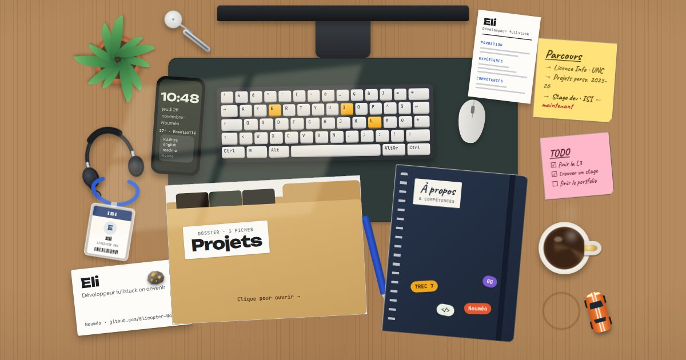

# Le bureau d'Eli

**Mon portfolio de développeur, pensé comme un vrai bureau.**

[**Entrer dans le bureau →**](https://elicopter-nc.github.io/portfolio/) &nbsp;·&nbsp; [Vue rapide](https://elicopter-nc.github.io/portfolio/rapide.html) &nbsp;·&nbsp; *English version included*

 

On arrive devant la porte de mon bureau, on l'ouvre, et on découvre ce qui traîne sur la table. Chaque objet raconte une partie de mon parcours.

## Sur le bureau

| | |
| --- | --- |
| **Le dossier Projets** | Les fiches sortent une à une au défilement, avec une capture trombonée, le défi technique et ce que le projet m'a appris. |
| **Le carnet** | Qui je suis, ce que j'utilise et ce que j'aime en dehors du code. |
| **Le badge** | Mon stage de développeur chez ISI, à Nouméa. |
| **Le CV** | La version papier, à lire sur place ou à télécharger. |
| **Les post-its** | Mon parcours, et une liste de choses à faire. |
| **Les petits drapeaux** | Pour passer le bureau en français ou en anglais. |

Le bureau suit aussi l'heure et la **météo réelles de Nouméa** : soleil par la fenêtre, pluie, coucher de soleil. La lampe le fait passer en mode nuit, le téléphone affiche mon dernier commit GitHub, et les objets se déplacent à la souris.

Pour les recruteurs pressés, la [**vue rapide**](https://elicopter-nc.github.io/portfolio/rapide.html) résume tout sur une seule page.

## Sous le capot

Fait à la main, sans framework ni étape de build :

- **HTML, CSS et JavaScript** (modules ES), objets dessinés en **CSS et SVG**
- Animations au défilement et transitions **FLIP** avec l'API Web Animations
- Données en direct depuis des **API publiques** : [Open-Meteo](https://open-meteo.com) pour la météo, l'API GitHub pour les commits
- Version **bilingue** sans bibliothèque, tout le contenu dans un seul fichier de données
- Pensé aussi pour le **clavier**, le **mobile** et les personnes qui préfèrent réduire les animations
